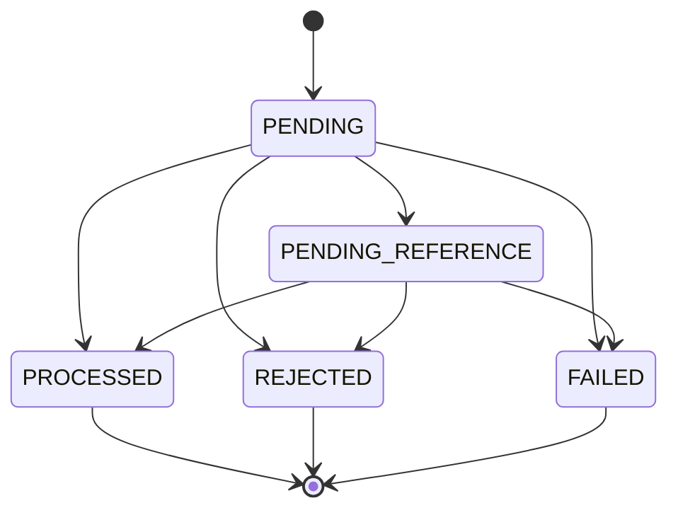

# Arquitetura do TCJG

## Objetivo da fundação

A fundação permite evoluir as regras financeiras sem acoplá-las ao framework,
ao banco ou ao transporte. NestJS é usado para composição e entrada da
aplicação; não é o lugar onde as invariantes financeiras vivem.

## Fluxo de dependências

```text
HTTP / SQS
    |
    v
Presentation ---> Application ---> Domain
                         ^
                         |
                  Infrastructure
```

Dependências de código apontam para dentro:

1. `domain` não depende de nenhuma outra camada da aplicação.
2. `application` depende do domínio e declara portas para recursos externos.
3. `presentation` traduz HTTP ou mensagens e chama casos de uso.
4. `infrastructure` implementa portas de persistência e mensageria.
5. `AppModule` conecta as implementações às abstrações.

Essa direção mantém o domínio testável com classes TypeScript comuns.

## Responsabilidade das camadas

### Domain

Contém value objects, aggregates, entidades, serviços e erros de domínio. Não
importa NestJS, MikroORM, AWS SDK ou tipos HTTP.

### Application

Coordena casos de uso e transações. Declara interfaces, chamadas de portas,
para repositórios, relógio, geração de identificadores e publicação de eventos.
Não conhece controllers nem detalhes do MikroORM.

### Presentation

Recebe dados de HTTP ou SQS, valida o formato, chama um caso de uso e traduz o
resultado para o protocolo. Não implementa regra financeira.

### Infrastructure

Implementa acesso ao PostgreSQL, mapeamento do MikroORM, SQS e outros serviços.
Entidades de persistência e mappers ficam aqui, separadas dos aggregates.

## Decisões da Fase 1

### ESM e imports `.js`

O projeto usa `module` e `moduleResolution` como `NodeNext`. Imports relativos
terminam em `.js`, mesmo nos fontes `.ts`, porque esse será o nome do arquivo no
JavaScript compilado.

### TypeScript estrito

`strict` permanece ativo sem desabilitar `strictPropertyInitialization`. O
compilador ajuda a impedir estados parcialmente inicializados, especialmente
importante nos objetos do domínio.

### Bun e Vitest

Bun instala dependências, executa scripts e roda o artefato compilado de
produção. Vitest continua sendo o framework de testes definido pelo projeto;
`bun run test` apenas o orquestra. Essa distinção é intencional e documenta com
precisão qual ferramenta exerce cada papel.

### NodeAdapter

A aplicação usa `@nestjs/platform-node`, que executa Nest diretamente sobre
`node:http`. O teste E2E cria a aplicação com o mesmo adaptador para evitar uma
diferença silenciosa entre teste e produção.

### Configuração validada

`@nestjs/config` carrega o ambiente e Zod valida/coage os valores durante o
bootstrap. Uma configuração ausente ou inválida impede a aplicação de iniciar,
em vez de falhar somente durante uma requisição.

### MikroORM e PostgreSQL

O `DatabaseModule` encapsula a integração com o MikroORM. A aplicação usa
configuração assíncrona para receber os valores já validados pelo
`ConfigService`. Entidades de persistência serão criadas na infraestrutura e
convertidas para objetos do domínio por mappers.

O schema será alterado apenas por migrations versionadas e reversíveis. As
tabelas financeiras serão introduzidas na fase de persistência, quando suas
constraints puderem ser definidas junto às entidades.

### Docker Compose

O ambiente integrado contém API, PostgreSQL e LocalStack. Health checks e
`depends_on` evitam iniciar a API antes das dependências estarem prontas. Isso
melhora a experiência local, mas a aplicação ainda deverá tratar falhas
transitórias em produção.

O LocalStack inicia apenas o serviço SQS. Um container de inicialização separado
cria `wager-transactions.fifo`, `wager-transactions-dlq.fifo` e
`wallet-events.fifo`. A fila de entrada possui `RedrivePolicy` com
`maxReceiveCount=5`. A API só inicia depois que esse container termina com
sucesso.

A imagem está fixada em `localstack/localstack:4.14.0`. As imagens calendarizadas
de 2026 passaram a exigir autenticação e encerram com código 55 sem um token.
Como o desafio usa somente SQS local, manter a última versão comunitária evita
uma dependência externa de conta/licença e torna o setup reproduzível.

A publicação de portas usa o intervalo 3000–3002, permitindo validar três
réplicas com `docker compose up --scale api=3`. Isso prova que a aplicação não
depende de estado mantido em um único processo.

### Teste de persistência no Bun

O teste de integração inicia o Vitest pelo executável do Bun, confirma a presença
de `process.versions.bun` e conecta a um PostgreSQL real. Uma entidade decorada
pelo MikroORM é persistida e recarregada de uma tabela temporária criada dentro
de uma transação. A tabela usa `ON COMMIT DROP`, portanto o teste não modifica o
schema permanente nem depende de sincronização automática.

## Money Value Object

`Money` é um value object imutável e compartilhado pelos módulos de wallet,
ledger e wagering. O domínio o armazena como `bigint` em centavos; `number`,
`float` e arredondamentos binários não participam do caminho monetário.

A entrada pública aceita somente uma string não negativa no formato
`^(0|[1-9]\\d*)\\.\\d{2}$`. Assim, escala, zeros à esquerda, notação científica
e sinais são tratados como parte do contrato, não como algo a ser corrigido
silenciosamente. Valores negativos só podem nascer de operações internas como
`subtract` e `negate`.

A moeda segue `^[A-Z]{3}$`. O modelo é multi-moeda mesmo que o primeiro fluxo
use BRL. `add`, `subtract`, `isLessThan` e `equals` exigem moedas iguais e lançam
`CurrencyMismatchError` em caso de divergência. Optamos por erro também em
`equals` para tornar explícito um uso incorreto do domínio, em vez de ocultá-lo
atrás de um simples `false`.

`toJSON` é o contrato de serialização e sempre retorna duas casas decimais:

```json
{ "amount": "25.00", "currency": "BRL" }
```

## Wallet Aggregate e ledger de domínio

`Wallet` é o Aggregate Root responsável por saldo, moeda, versão e datas de
alteração. O construtor é privado: `open` cria uma wallet com saldo zero e
versão 1, enquanto `rehydrate` recompõe exatamente o estado confiável vindo da
persistência, sem reexecutar transições de negócio.

Saldo inicial positivo não é argumento de `open`. Na fase de aplicação, ele
será representado por uma transação interna `OPENING` e por um crédito na mesma
transação SQL. Dessa forma, nenhum saldo nasce sem uma explicação no ledger.

`credit` e `debit` aceitam apenas `Money` positivo e da moeda da wallet. Valor
zero ou negativo é rejeitado porque o contrato sempre retorna um lançamento e
o ledger não admite lançamentos sem efeito. Uma rejeição não altera saldo,
versão nem `updatedAt`. Débito que produziria saldo negativo lança
`InsufficientFundsError`.

Cada operação calcula `balanceBefore` e `balanceAfter`, cria e valida um
`WalletLedgerEntry` e somente depois aplica a mudança ao aggregate. Assim, uma
falha na criação do lançamento não deixa a wallet parcialmente alterada. Uma
operação válida incrementa `version` uma única vez e usa o instante recebido
como novo `updatedAt`.

`WalletLedgerEntry` contém apenas dados imutáveis: wallet, transação, direção,
valor, saldos anterior e posterior e data de criação. Sua factory rejeita valor
não positivo, saldos negativos, moedas divergentes e aritmética incompatível
com a direção. A factory `rehydrate` recompõe exatamente o lançamento persistido
sem repetir essas validações de transição; inconsistências continuam observáveis
por `isBalanced` e serão tratadas pela reconciliação. A persistência, constraints
e proteção contra `UPDATE`/`DELETE` serão adicionadas na fase de banco de dados.

O lançamento não possui um identificador de negócio adicional no domínio: o par
`walletId + transactionId` expressa a identidade e a regra de no máximo um
lançamento por transação e wallet. Na persistência, a Fase 6 adicionará `seq`
como chave técnica e cursor estável, além da constraint única sobre esse par.
Isso evita introduzir geração de identificadores dentro do aggregate sem perder
nenhuma garantia exigida pelo enunciado.

## WagerTransaction e máquina de estados

`WagerTransaction.create` sempre inicia em `PENDING`. `REFUND` e `ROLLBACK`
exigem o identificador externo da referência já na criação; a resolução para o
identificador interno ocorre antes de `markProcessed`. `rehydrate` recompõe o
estado persistido sem repetir regras de transição.



`PROCESSED`, `REJECTED` e `FAILED` são terminais. Qualquer tentativa de sair
deles lança `InvalidTransactionStateError`, sinalizando erro de programação.
`PENDING_REFERENCE` não pode transicionar novamente para si próprio.

`affectsBalance` combina kind e estado: `LOSS`, `REJECTED` e `FAILED` nunca
afetam saldo nem expõem direção de ledger. `BET` gera `DEBIT`; `WIN`, `REFUND`
e `OPENING` geram `CREDIT`. O `ROLLBACK` inverte a referência: `BET` vira
`CREDIT`, enquanto `WIN` e `REFUND` viram `DEBIT`. Referências a `LOSS`,
`OPENING` ou outro `ROLLBACK` são inválidas.

`OPENING` existe no domínio para o crédito interno de abertura, mas não é um
kind aceito pela política de entrada externa. Controllers e consumidores devem
usar `parseExternalWagerTransactionKind` antes de criar a transação. Assim o
domínio suporta o caso interno sem permitir que API ou fila o forjem.

### Hash canônico e idempotência

O `payloadHash` é SHA-256 hexadecimal do JSON canônico: chaves ordenadas
recursivamente, sem espaços e com propriedades `undefined` omitidas. Participam
somente `providerId`, `externalTransactionId`, `playerId`, `walletId`, `roundId`,
`gameId`, `kind`, `money { amount, currency }` e, quando presente,
`referenceExternalTransactionId`.

Identificador interno, `Idempotency-Key`, datas e metadados de transporte não
entram no hash. A chave identifica a tentativa; o hash distingue replay idêntico
de conflito sob a mesma chave.

### Taxonomia de failureCode

| Código                        | Situação                                           | Orientação ao provedor                |
| ----------------------------- | -------------------------------------------------- | ------------------------------------- |
| `INSUFFICIENT_FUNDS`          | BET sem saldo                                      | Não reenviar                          |
| `REVERSAL_INSUFFICIENT_FUNDS` | Reversão deixaria saldo negativo                   | Não reenviar; tratar operacionalmente |
| `CURRENCY_MISMATCH`           | Moeda diferente da wallet                          | Corrigir o payload                    |
| `WALLET_NOT_FOUND`            | Wallet inexistente                                 | Corrigir o payload                    |
| `PLAYER_WALLET_MISMATCH`      | Wallet pertence a outro player                     | Corrigir o payload                    |
| `REFERENCE_NOT_FOUND`         | Referência não chegou dentro do limite             | Não reenviar                          |
| `REFERENCE_MISMATCH`          | Provider, player, wallet, moeda ou rodada divergem | Corrigir o payload                    |
| `INVALID_REFERENCE_KIND`      | Tipo de referência não permitido                   | Corrigir o payload                    |
| `INVALID_REFERENCE_STATE`     | Referência não está `PROCESSED`                    | Não reenviar                          |
| `AMOUNT_MISMATCH`             | Valor diferente da referência                      | Corrigir o payload                    |
| `ALREADY_REVERSED`            | Referência já revertida pelo mesmo tipo            | Não reenviar                          |
| `INTERNAL_FAILURE`            | Falha permanente de infraestrutura                 | Contatar suporte                      |

## Persistência financeira e constraints

O schema financeiro é criado por uma migration explícita e reversível. Ela
define as tabelas `wallets`, `wager_transactions`, `wallet_ledger_entries`,
`inbox_messages` e `outbox_messages`; sincronização automática de schema
permanece desativada.

As entidades de persistência são separadas dos aggregates de domínio. Valores
`numeric(20,2)` chegam do PostgreSQL como `string` e os mappers os convertem
explicitamente com `Money.from`, evitando perda de precisão por `number`.

As invariantes que também precisam resistir a concorrência ou escrita direta
são reforçadas no PostgreSQL:

- uma wallet por jogador e moeda, saldo não negativo e versão válida;
- unicidade por transação externa do provider e por chave de idempotência;
- tipos, estados, códigos de falha e referências obrigatórias de transações;
- apenas uma reversão `PROCESSED` de cada tipo por transação de referência;
- aritmética do ledger validada por `CHECK` e registros append-only protegidos
  por trigger contra `UPDATE` e `DELETE`;
- chave composta do inbox para deduplicação e índice parcial do outbox pendente.

`attempts` e `next_attempt_at` pertencem à persistência e serão controlados
pelos casos de uso de retry, sem contaminar a máquina de estados do domínio.
A suíte de integração usa um schema aleatório, testa `up/down/up` e provoca
violações de cada constraint. A Fase 7 conecta esse schema aos primeiros
endpoints financeiros.

## Fatia vertical financeira e concorrência

`CreateWallet` e `ProcessWagerTransaction` dependem da porta
`FinancialTransactionPort`, não do MikroORM. O adapter abre uma transação SQL e
entrega um `FinancialTransactionContext` ao caso de uso. Esse contexto poderá
ser reutilizado pelo consumidor SQS para incluir o inbox na mesma transação sem
duplicar a regra financeira.

### Lock pessimista por wallet

Depois da verificação inicial de idempotência, o adapter executa
`SELECT ... FOR UPDATE` somente na wallet afetada e configura
`SET LOCAL lock_timeout = '5s'`. Escolhemos lock pessimista porque o lançamento
precisa do `balanceBefore` exato e porque a sequência leitura, regra de domínio,
wallet e ledger fica simples de auditar. A contenção é local à wallet: operações
em wallets distintas continuam paralelas.

Não usamos optimistic retry como mecanismo principal porque ele repetiria toda
a regra e aumentaria a chance de contenção numa hot wallet. Ainda assim, o
`UPDATE wallets ... WHERE id = ? AND version = ?` funciona como defesa em
profundidade. Os `CHECK`s do banco impedem saldo negativo mesmo diante de uma
falha de aplicação. Timeout de lock e deadlock são falhas transitórias e viram
HTTP `503` com `Retry-After`.

### Idempotência e atomicidade

A chave do header é persistida e o hash considera somente o payload financeiro
canônico. Hash igual devolve `balance_after`, que preserva o saldo observado na
primeira execução; hash diferente gera `409`. Se duas instâncias passam juntas
pela leitura inicial, a constraint decide a corrida com `23505`: a transação
perdedora faz rollback, abre uma nova transação e relê o resultado vencedor.

O `@nestjs/idempotency` foi avaliado, mas não é usado nesta operação financeira.
O desafio exige que chave, `payload_hash`, resultado, `balance_after` e a
constraint concorrente pertençam ao próprio `wager_transactions` e à mesma
transação do saldo. Um interceptor com um segundo armazenamento de recibos
criaria outra fronteira transacional e duas fontes de verdade. O controller
valida a presença do header; o caso de uso e o PostgreSQL continuam sendo a
garantia definitiva.

Wallet, wager transaction, ledger e mensagens de outbox são gravados na mesma
transação SQL. `BET` debita, `WIN` credita e `LOSS` não altera saldo nem gera
ledger. Saldo insuficiente é persistido como `REJECTED/INSUFFICIENT_FUNDS`, sem
lançamento. Eventos são apenas enfileirados na outbox; a publicação pertence à
fase do worker.

O `@nestjs/outbox` também foi avaliado. Ele administra schema, tabelas e ciclo de
dead-letter próprios, enquanto o desafio prescreve `outbox_messages`, suas
colunas, o índice parcial e o algoritmo `FOR UPDATE SKIP LOCKED`. Mantemos a
porta e o schema exigidos pelo desafio; o worker específico será conectado na
fase de outbox sem trocar o contrato persistido nesta fatia.

Uma wallet com saldo inicial nasce em versão `1`, junto de uma transação interna
`OPENING` e um lançamento `CREDIT`. Isso representa o estado inicial, não uma
mutação posterior à criação. A constraint de jogador e moeda converte criação
duplicada em `409`.

### SOLID aplicado de forma pragmática

Esta fatia possui dois casos de uso: `CreateWallet` e
`ProcessWagerTransaction`. Cada um tem uma responsabilidade de aplicação; os
controllers cuidam do contrato HTTP, os aggregates das invariantes e o adapter
da persistência. Isso aplica SRP sem criar uma classe para cada instrução.

Os casos de uso dependem de `FinancialTransactionPort`, e o MikroORM implementa
essa porta na composição do NestJS (DIP). Outro adapter pode substituí-lo sem
alterar a regra financeira (OCP/LSP). O `FinancialTransactionContext` reúne
somente operações que precisam participar da mesma transação SQL; dividi-lo em
interfaces menores agora fragmentaria uma unidade atômica coesa, portanto não
forçamos ISP além do que o fluxo realmente consome.

## API de consulta e fronteira HTTP

As quatro consultas da Fase 8 dependem de `FinancialQueryPort`. Essa porta de
leitura é separada de `FinancialTransactionPort`: consultas não recebem métodos
de escrita nem abrem uma transação financeira apenas para carregar uma projeção.
O adapter MikroORM converte entidades de persistência em read models e os casos
de uso convertem datas para o contrato HTTP.

O ledger é ordenado pelo `bigserial seq` e usa keyset pagination, não `OFFSET`.
O cursor é o `seq` codificado em base64url e validado de forma canônica. Cada
página consulta `seq > cursor`, ordena crescente e busca `limit + 1`; o item
extra informa se existe próxima página. Uma inserção concorrente pode aparecer
numa página posterior, mas não desloca nem repete lançamentos já lidos.

`FinancialExceptionFilter` é global e converte erros de aplicação, validação e
infraestrutura no envelope `{ error: { code, message, retryable } }`. Conflitos
retornam `409`, ausências `404`, entrada inválida `422` e falhas transitórias
`503` com `Retry-After`. Erros inesperados são registrados e devolvem mensagem
genérica para não vazar detalhes internos.

`ProviderAuthGuard` também é global, enquanto `GET /` é explicitamente público.
O guard depende de `ProviderIdentityPort` e impede que a identidade autenticada
opere com outro `providerId`. O adapter atual é no-op e deriva a identidade do
próprio request porque o desafio não define credencial ou protocolo de login.
Não adotamos `@nestjs/authentication` nesta fase: o pacote cobre o ciclo completo
de usuários, sessões e sign-in, maior que a fronteira solicitada. Uma integração
real de JWT, API key ou mTLS substitui apenas o adapter da porta.

## Transactional outbox e eventos de integração

Os casos de uso criam subclasses de `IntegrationEvent<T>` em vez de informar o
tipo por uma string no call site. Cada envelope recebe UUID v7, versão, contexto
de correlação e apenas dados serializáveis; valores monetários entram como
`{ amount, currency }`, nunca como instâncias de `Money`. `OutboxMessage.enqueue`
transforma o evento no registro persistido pela mesma transação de wallet,
wager e ledger.

O pacote oficial `@nestjs/outbox` foi avaliado, porém administra schema,
migrations e tabelas próprios. O desafio exige a tabela `outbox_messages`
existente, seu índice e o algoritmo explícito de lease; manter o adapter local
evita duas fontes de verdade e conserva o contrato avaliado.

Cada réplica executa `OutboxWorker`. Uma única instrução PostgreSQL reivindica
um lote, usando `FOR UPDATE SKIP LOCKED`, e move `next_attempt_at` para o fim do
lease antes de confirmar a transação. Publicação e atualização de estado ficam
em transações distintas por definição: sucesso no SQS marca `published_at`;
falha incrementa `attempts` e agenda backoff exponencial com jitter. As duas
atualizações exigem o valor exato do lease, servindo como fencing para impedir
que um worker atrasado sobrescreva uma reivindicação mais nova.

O SQS FIFO recebe `eventId` como `MessageDeduplicationId` e `aggregateId` como
`MessageGroupId`. Ainda assim, a garantia é at-least-once: um crash depois do
envio e antes de `published_at` pode republicar depois da janela do SQS. Por
isso o inbox persistente do consumidor continua obrigatório na fase seguinte.
Mensagens da outbox nunca são apagadas; atingir o limite de tentativas gera
alerta e os retries continuam no intervalo máximo.

O worker usa um loop assíncrono sem sobreposição, participa do shutdown do Nest
e termina o lote em andamento antes de encerrar. `getLagSeconds` calcula a idade
do evento pendente mais antigo para a futura métrica `outbox_lag_seconds`.

## Consumidor at-least-once e inbox transacional

O consumidor SQS é somente um adapter de entrada. Ele valida o envelope e chama
`ProcessWagerMessage`, que abre uma transação pela mesma
`FinancialTransactionPort` usada no HTTP. Dentro dela, o insert do inbox usa
`ON CONFLICT DO NOTHING`; mensagens já existentes são relidas com lock. Se o
hash divergir, a mensagem é inválida. Se `processed_at` já existir, o fluxo
financeiro não roda novamente.

Quando a mensagem é nova, `ProcessWagerTransaction` recebe o contexto já aberto.
Assim, inbox, atualização da wallet, wager, ledger e outbox confirmam ou revertem
juntos. O ack fica fora dessa fronteira e acontece somente após o retorno da
transação. Um crash nesse intervalo produz redelivery, que encontra o inbox
processado e não repete o efeito. A idempotência do inbox protege a entrega da
mensagem; a chave e o hash de `wager_transactions` continuam protegendo a
operação financeira. São garantias complementares, não caches concorrentes.

Erros de schema, conflito de inbox ou conflito definitivo de idempotência são
classificados como permanentes. Indisponibilidade, lock timeout e erros
inesperados permanecem transitórios. Ambos respeitam visibility timeout com
backoff e o limite configurado; no limite, o adapter publica na DLQ e só depois
remove a mensagem original. O `MessageGroupId = walletId` reduz reordenação, mas
o lock por wallet e as constraints do PostgreSQL continuam sendo a garantia.

O consumer limita concorrência por instância, cancela o long polling no
shutdown e espera trabalhos iniciados. Mensagens do lote ainda não iniciadas
recebem `ChangeMessageVisibility(0)`, permitindo que outra réplica as assuma sem
esperar o timeout normal.

## Convenções

- Arquivos TypeScript usam nomes em `kebab-case`.
- Classes e tipos usam `PascalCase`.
- Imports relativos ESM terminam em `.js`.
- Testes unitários ficam próximos ao código testado.
- Testes E2E ficam em `test/`.
- Controllers não acessam o ORM diretamente.
- Aggregates não recebem dependências do NestJS.
- Mudanças de schema exigem migration com `up` e `down`.

## Próximas fases

A próxima fase conecta o consumo SQS, deduplicação por inbox e política de
retry às mesmas portas transacionais.
